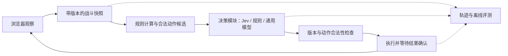

# Jev 与 Hentaiverse Helper 重构调研

调研日期：2026-10-13。范围：官方文档、官方源码、原始研究；未调用付费 API，未复现第三方实验。文中将产品文档、厂商测评与我们的工程推论分别表述。

2026-10-14复核：官方价格仍为每百万输入token $0.042、输出免费，型号仍为 `jev-1.13.0`，Choice上限仍为255。并行问题示例实际使用 `jev-1.12`，不可当成当前型号或本项目的实测。前文保留最初调研建议；后续访谈已接受的取舍以 [ADR目录](../adr) 为准，末尾汇总首版实施方案供整体确认。

## 初步判断

**Jev 很适合成为本项目的回合决策候选后端。** Hentaiverse 当前状态可以结构化，下一步动作可以枚举，决策频繁且通常不需要生成文字；这与 Jev 的接口十分相近。但适配接口不等于已经具备优秀的游戏策略，仍需用本项目状态和完整战斗评估。

## 官方身份与产品边界

官网是 [typesafe.ai](https://typesafe.ai/)，从官网链接到 [docs.typesafe.ai](https://docs.typesafe.ai/introduction/quickstart)、`console.typesafe.ai`。搜索结果中的 `typesafeai.org`、`jevtypesafeai.com` 等相似域名不能作为官方接口来源。

TypeSafe 将 Jev 称为 System One 模型，定位是软件内的狭窄判断，采用其称为 RLCD 的训练方法，返回概率和类型化结果。官方所说的“零幻觉”主要指输出遵守给定 schema，不能理解为零决策错误。官网也明确这种格式保证并非实测任务错误率。[官网说明](https://typesafe.ai/)、[模型定位](https://docs.typesafe.ai/concepts/system-one)

## 接口与约束

官方 HTTP 接口为 `POST https://api.typesafe.ai/v1/systemone`，请求包含 `model`、`state`、`questions`；使用 Bearer API Key。`state` 可以是字符串、对象或数组；结果有 `model`、`answers`、`usage`。这不是现有 Chat Completions 接口的直接换名。[API 文档](https://docs.typesafe.ai/api)

| 原语 | 结果 | 本项目可尝试用途 |
| --- | --- | --- |
| Choice | 一个选项、各选项概率、confidence | 从合法“动作＋目标”候选中选一个 |
| Score | 有序等级的概率加权位置、分布、confidence | 按明确描述评价威胁或资源压力 |
| Noul | 某命题成立的概率，0–1 | 对难以写死的语义条件做判断 |

Choice 最多 255 个选项；Score 为 2–10 个等级，其值不一定是整数。问题 ID 不进入模型推理，含义必须写进 instructions/criteria。所有问题独立读取同一 state，并行返回；不能假设后一个问题看到了前一个答案。[Choice](https://docs.typesafe.ai/primitives/choice)、[Score](https://docs.typesafe.ai/primitives/score)、[API](https://docs.typesafe.ai/api)、[并行问题](https://docs.typesafe.ai/cookbooks/parallel_questions)

JavaScript/TypeScript 官方包是 `@typesafe-ai/sdk`，主要入口 `TypeSafeClient.systemOne()`；文档支持 Node.js 20+，提供 ESM、CommonJS 和类型推导。当前官方文档链接的 SDK 源码版本为 v0.6.0；浏览器扩展集成仍应核验打包及运行环境，不能由 Node 支持直接推导。[SDK 文档](https://docs.typesafe.ai/sdk/javascript)、[官方客户端源码](https://github.com/typesafe-ai/typesafe-sdk-js/blob/v0.6.0/src/client.ts)

当前型号为 `jev-1.13.0`，`jev-latest`、`jev-preview` 均指向它。输入仅文本，没有图像、音频、视频能力；总请求 64k tokens，state 加最长问题不超过 32k。公布限流为 100k tokens/s 和 80 requests/s，仍可能动态调整。适配时应固定版本并记录响应型号。[Models](https://docs.typesafe.ai/models)

未在本次查阅的官方资料中找到可下载权重或本地推理方式。官方提供的是托管 API，并明确不提供客户数据微调或 LoRA，领域知识由 state 和问题描述注入。因此本次评估按云端 API 产品处理；“SDK 开源”不能当作“模型开源”。[Models](https://docs.typesafe.ai/models)、[官方 SDK](https://github.com/typesafe-ai/typesafe-sdk-js)

## 概率和 confidence 到底是什么

官方将校准解释为：在大量类似预测中，预测概率与实际发生频率接近。这是分组统计性质，对单次判断没有正确性保证，也没有自动承诺迁移到 HV 后仍然校准。[AI primer](https://docs.typesafe.ai/introduction/machine-learning-primer)

Choice 的 confidence 是由概率计算的统计量，并非额外预测器，也不是熵：

```text
confidence = (p_max - 1/n) / (1 - 1/n)
```

三选一最高概率 0.6 时，confidence 为 0.4。Score 的 confidence 按概率到最可能等级的距离计算；Noul 不返回单独 confidence。因此不能把 confidence、最高选项概率与战斗胜率混用。[Confidence](https://docs.typesafe.ai/confidence)

**我们的推论：** “选择攻击 A 的概率为 0.9”不能读成“执行攻击 A 后有 90% 胜率”。前者依赖问题和候选集合；后者需要明确未来策略、时间范围、随机性及结果数据。多个近似等价攻击候选也可能分摊概率，导致 confidence 低，却不代表必须调用更贵模型。

一篇独立预印本对 Jev 1.13.0 在 37 个数据集上做了 346,009 次请求，报告 Choice 校准表现较好，但二分类概率用固定 0.5 阈值时存在问题；在 UNFAIR-ToS 上调节训练集阈值使 micro-F1 从 0.50 提升到 0.75。这支持“阈值必须按任务验证”，不能证明 HV 决策已可靠。作者公开了代码和原始响应，我们未复现。[原始论文](https://arxiv.org/abs/2609.37647)、[实验仓库](https://github.com/AppliedMachineLearning-Lab/jev-benchmarking)

## 成本与速度

公布价格是每百万输入 tokens **$0.042**，输出免费。举例：若每回合实际计费输入为 2,000 tokens、每回合一次请求，10,000 回合约为 **$0.84**；5,000 tokens 则约 **$2.10**。这是按标价计算的示例，不包含重试、其他模型或基础设施；真正预算应使用响应 `usage.input_tokens`。[定价](https://docs.typesafe.ai/models)

同一请求内可共享 state，多问题仍增加输入 tokens。官方批处理示例说明共享长文档能减少重复输入计费，但其加速对照是串行多次调用，不能照搬成任何应用都快十倍。该示例还出现少量重复调用波动，因此应实测一致性，而不是假定严格确定性。[并行问题实测](https://docs.typesafe.ai/cookbooks/parallel_questions)

厂商发布文声称端到端 70–500ms，并说明主要从美国西海岸测量。主页的 193.6 倍速度、444.6 倍成本优势来自其特定工作流评估，参考答案由强模型生成，厂商也承认收益位于较高端。它们不是本项目实测，也不是我们的网络延迟承诺。[发布说明及测评限制](https://typesafe.ai/blog/introducing-system-one-models-and-jev)

## 直接影响本项目的能力短板

官方 1.13 局限文档于 2026-10-02 复核，明确列出算术和计数不可靠、多跳推理较弱、无关长上下文降低准确率、选项顺序偏置，以及不能生成自由文本。对抗性 state 也可能影响判断。应把血量百分比、冷却、消耗、可用性等先在代码中算好，给模型短小而明确的决策材料；Score 不能用于插值还原精确伤害值。[已知局限](https://docs.typesafe.ai/model-jaggedness/jev-1.13)

官方称英语训练最多、效果最佳。因此 HV 原本的英文技能和状态名可以保留，初期比较英文与中文问题模板的实际效果。[语言说明](https://docs.typesafe.ai/models)

官方 Doom 演示读取结构化文本状态；作者承认传统游戏 bot 可以玩得更好。它证明接口能接入快速游戏循环，但没有证明 Jev 擅长长期资源规划或 HV 战斗。[Doom 演示说明](https://typesafe.ai/blog/introducing-system-one-models-and-jev)

## 尚未验证

- 本账号是否已获 API 使用权限，实际计费 tokens、请求耗时和失败率。
- Jev 对 HV 技能、敌人机制和装备组合的理解，以及动作排序质量。
- 完整战斗成功率、消耗品成本、平均回合数，与规则策略及普通 LLM 的差距。
- 在动态候选数、等价候选和不同顺序下，概率、confidence 及阈值是否稳定。
- 本项目运行网络下的 p50/p95 延迟、超时和限流行为。

以上待验证项适合通过固定模型版本的离线样本、只观察不执行的影子运行、再到受控实战逐步解决。

## 与本工程的匹配判断

以下为结合仓库代码的工程判断，不是 Jev 在 Hentaiverse 上已经测出的效果。

**建议把 Jev 作为重构后逐回合动作选择的首个候选模型；整体架构围绕可靠的战斗闭环和可替换的决策模块建立。** 项目的输入本来就来自 DOM，输出本来就是有限动作，这与 Jev 的 Choice 形态契合。是否比规则策略或受约束输出的通用模型打得更好，尚需本项目评测。

| 本项目需求 | 匹配判断 | 实现责任 |
| --- | --- | --- |
| 在合法动作中选择本回合行动 | 高 | Jev 在代码提供的完整候选中选一个 |
| 伤害、费用、冷却与资源比较 | 需要代码支持 | 可确定的量用规则计算；估计量标明区间和依据 |
| 连续多轮的资源管理 | 有条件 | 代码保存历史和资源预算，提供短期后果估计 |
| 从 HTML 提取状态、点击并确认结果 | 由代码承担 | 浏览器模块负责同步和错误恢复 |
| 战术解释、整理陌生机制 | 通用模型更适合 | 可在离线分析或少量复杂局面中使用 |
| 小马图像识别 | 当前 Jev 无对应输入能力 | 作为独立流程处理；初期检测到即暂停 |

### 游戏证据及外推范围

开源项目 [christianmat/jev-pokemon](https://github.com/christianmat/jev-pokemon) 的作者报告通关 Pokémon Red：16,150 次决策、约 39.2M 输入 token、约 $1.65、决策延迟中位数约 0.4 秒。其代码框架读取模拟器内存，提供合法动作、属性克制、伤害估计和导航信息，并有失败循环处理。这说明该搭配具有可行性；这是作者报告的单项目结果，并非我们复现或 Hentaiverse 对照实验。

2026-10-01 预印本 [Code Owns the Simulation, Jev Owns the Evaluation](https://arxiv.org/html/2610.01834v1) 使用 `jev-1.13.0`，观察到它在需要先推演再评价的任务上容易失败。ALFWorld 中，加入环境副本的前瞻模拟后，成功率从 31% 提升到 87%。这支持“提供候选动作的后果供其评价”的设计；Hentaiverse 目前没有可复制的完整环境，不能照搬这组收益。

2026-10-08 预印本 [Can Jev be Your Q or Policy in Reinforcement Learning?](https://arxiv.org/html/2610.11692v1) 探索把冻结的 Jev 用作策略参考、探索判断和经验回放评分。它也区分了用于排序的评分与具有可加减单位的价值函数。对本项目的启示是：先做动作选择和数据记录；长期可以研究策略学习，但目前缺少环境、轨迹和明确奖励，不宜把重构首期变成强化学习工程。两篇论文有重合作者，均属早期预印本，不应视作多组成熟独立验证。

### 现有代码为何需要改造

静态阅读基于提交 `2cae4c9`，本次没有运行游戏或调用真实模型。

1. **观察与执行没有形成确认闭环。** [`content.ts`](../../src/browser/content.ts) 在模型回调中点击，随后继续读取 DOM，没有等待动作响应完成。仓库留存的 [`hvc.js`](hvc.js) 显示游戏通过异步请求更新多个面板。更快的模型可能更容易读到旧状态，或者在游戏仍处理上次动作时提交下一次动作。
2. **动作身份依赖文本猜测。** [`command-io/utils`](../../src/command-io/utils/index.ts) 对目标、物品和技能使用编辑距离匹配，且在分辨动作种类前就解析目标和物品。模型返回的字符串与实际按钮之间缺少可靠绑定。
3. **状态可能读错。** [`battle-parser`](../../src/battle-parser/src/index.ts) 给每只怪物读取效果时使用整个怪物面板的选择器，会混入其他怪物的效果；未知稀有度固定填 Ordinary。当前快照也缺少显式的数据完整性和来源标记。
4. **执行存在具体缺陷。** [`browser/utils.ts`](../../src/browser/utils.ts) 的怪物、物品选择器缺少 `#`；技能采用数字 ID 拼接 CSS 选择器，需转义或直接使用 `getElementById`。[`content.ts`](../../src/browser/content.ts) 的胜利判断在同一字符串等于 `You are victorious` 后，又要求它等于 `challenge cleared`，最终胜利分支不可达。
5. **决策流程绑定聊天协议。** [`pipeline`](../../src/command-io/src/pipeline/index.ts) 保存战斗和轮次的模型分析，再逐回合拼入上下文；[`battle-turn`](../../src/prompt-builder/src/battle-turn/index.ts) 要求生成分析和 JSON；[`llm`](../../src/command-io/src/llm/index.ts) 写死供应商与模型。这些都不适合直接套到 Jev 的 state/questions 接口上。

可保留的资产包括页面样本、战斗术语、机制资料和 DOM 定位经验；解析结果与枚举映射仍需用样本核对。模型更换本身不能修复这些问题。

## 建议的重构结构



保持 TypeScript 即可。第一期在单仓库中建立少量有明确职责的模块，不必同时引入微服务、向量数据库、完整模拟器或复杂 Agent 框架。

- **Browser 模块**：隐藏 DOM 差异、按钮操作、异步更新、暂停恢复和页面切换。执行结果明确区分已确认、被拒绝、状态过期、结果未知。超时后先重新观察，不能盲目重放可能已经生效的动作；本地去重并不等于服务器保证恰好执行一次。
- **Battle 模块**：保存经过校验的快照、近期行动、资源消耗和可确认的机制；枚举完整合法动作。缺失数值保留 unknown，不填成零或普通怪。怪物数据库可缓存，缺失时降级，不能使整个观察流程依赖外部请求成功。
- **Decision 模块**：在 `choose(snapshot, candidates)` 这一 Interface 后实现 Jev、规则基线和通用模型 Adapter。返回候选 ID 与决策元数据，不生成浏览器选择器或任意命令。这个 Seam 有实际用途：同一批状态可公平比较不同策略。
- **Session 模块**：管理 observe → decide → execute → confirm 生命周期，一个会话只允许一个未完成动作。记录请求版本，拒绝过期响应；刷新后重新观察再恢复。模型密钥和远程调用放在扩展后台或本地运行进程，content script 只负责页面交互；最终部署方式再随实际使用场景确定。
- **Replay 模块**：记录 `before / candidates / decision / execution / after`，以及模型版本、规则版本、耗时、用量与错误。用已录轨迹提供第二种环境 Adapter，支持解析回归与决策比较。

### Jev 应看到什么

候选应是已经绑定动作和目标的组合，例如 `attack_monster_2`、`cast_cure_self`、`use_health_potion_slot_1`。每个候选同时有简短英文描述、资源成本、作用对象与已知效果；浏览器内部执行数据不必全部发给模型。候选只在产生它的快照版本内有效。

推荐初期使用一个 Choice 选择完整动作。不要把“用什么技能”和“打谁”当成互不依赖的并行问题，否则可能拼出不合法或战术上矛盾的组合。候选超出供应商限制时才引入分组/分层，并评估筛选是否误删关键动作。

输入保留紧凑状态与有用语义：当前与最大 HP（可获取时）、费用、冷却、Buff 剩余时间（可获取时）、资源预算、上次动作结果。代码补充“治疗会溢出”“这一动作会消耗预留资源”等可验证事实。伤害/生存预测尚不能可靠计算时，标明估计和不确定性，不虚构精确死亡概率。原始数值与语义标签都可保留，由实验决定表示方式。

模型的选项概率表示其对所提问题的判断分布，不能当成该动作带来的胜率。候选数量、描述和顺序都会影响解释；两个近似等价攻击分摊概率，也不意味着局面危险。低置信度时如何采用规则、升级到通用模型或暂停，应以本地评测决定，不预设一个万能的 0.8 阈值。

## 开始重构前最值得做的验证

建议先以单手战斗作为试点，按以下顺序交付可验证的小阶段：

1. **修复并录制观察执行闭环。** 利用已有 HTML 建立解析回归，补充多怪不同效果、低资源、冷却、轮次结束、验证码和部分页面更新样本。执行测试覆盖重复点击、迟到响应、动作超时以及手动操作导致的状态变化。此阶段先用规则策略或人工选择验证动作执行。
2. **构建有标注的决策集。** 首批建议约 100–300 个不同状态，覆盖补血、补蓝、维持 Buff、集火、精神姿态及长战斗资源保留；标记允许的好动作集合，而非强行指定唯一答案。按完整战斗划分开发集与留出集，避免相邻回合泄漏。
3. **在相同信息条件下比较三条策略。** 规则基线、Jev Choice、使用受约束动作输出的通用模型。模型之间共享状态、动作集合和机制事实；分别测 Jev 原始状态与增加规则特征后的表现。重排候选测试顺序偏置，记录实际模型版本，不只保存 `jev-latest`。
4. **先影子决策，再测完整战斗。** 离线状态只能检验局部选择和合法性，无法证明某次替代动作会带来怎样的后续胜率。完整战斗阶段比较同配置、同难度下的完成率、资源消耗、回合数、人工介入、决策端到端 p50/p95、超时和费用，并记录样本量与随机性。

成功标准应在实验前写下：执行阶段无无效/过期候选提交，决策质量在留出集达到约定水平，完整战斗表现不劣于规则基线且延迟、费用有实际收益。未达标时仍保留可靠闭环和记录工具，替换决策 Adapter 即可。

本次产出仅为调研与设计建议。未申请账户、未安装 Jev SDK、未提交模型请求、未进行实战测试，也未改动运行代码。

## 2026-10-14：个性化打法与强化学习访谈

用户已确认的首期边界和成本取舍见 [ADR 0001](../adr/0001-initial-automation-scope.md)。用户明确不预设“稳定通关优先”，并确认通过亲自游玩几场的记录学习情境化取舍，不要求动作复刻，见 [ADR 0002](../adr/0002-learn-preferences-from-play-demonstrations.md)。训练方案仍待决定。

### 已核实的能力边界

[官方 Models](https://docs.typesafe.ai/models) 明确：不支持客户数据微调或LoRA，同一套权重服务所有账号，不使用客户请求或响应进行训练。定制通过 `state`、`instructions` 和 `criteria` 完成。不能假设重复游玩会更新Jev权重或自动形成可供后续调用使用的个人记忆。

[Jev 与 RL 预印本](https://arxiv.org/html/2610.11692v1) 的方法是冻结Jev，辅助另一个可训练策略：提供参考动作、指导探索、评价经验回放的学习优先级。实验覆盖9个MiniGrid任务和3个Atari游戏，收益随任务和集成方式变化；并非直接训练Jev，也没有HV验证。研究的参考策略可以帮助学生超过直接Jev控制，但不是保证。Jev的Choice概率及Score分数不能未经验证就当作长期收益或用户偏好真值。

### 路线对照

| 路线 | 更新的内容 | 需要的用户信号 | 验证重点 |
| --- | --- | --- | --- |
| 示例辅助决策 | 外部保存的示范及纠正；每次选择相关内容提供给Jev | 正常游玩的选择、少量纠正 | 在未见局面是否更符合用户取舍；不属于参数训练或RL |
| 模仿学习 | 另一个动作分类或排序策略的参数 | 决策前状态、可用候选、用户动作 | 对用户动作的一致性及完整战斗中的表现 |
| 偏好学习 | 从比较反馈学习的偏好或奖励模型 | 两个动作、片段或结果中更喜欢哪个 | 能否预测留出的用户偏好；偏好学习本身不等于RL |
| 强化学习 | 根据轨迹和奖励优化的独立策略 | 认可的奖励来源、交互或足够的离线轨迹 | 长期目标改善，探索成本与分布外行为 |

用户已接受首版先归纳和审阅偏好，再供冻结Jev决策时使用，暂不训练独立策略，见 [ADR 0003](../adr/0003-browser-extension-with-external-preferences.md)。上表其他训练路线仍是未来研究选项。Jev输出与用户示范须分别标记，不能把模型自己的动作自动当作用户认可的标签。用户实际操作也可能包含误触、临时实验或特殊局面，需要允许纠正。

强化学习仍需要“什么算更好”的信号；可以从用户比较中学习，不必由开发者预先写死胜率、速度、药耗的权重。只记录已执行动作的结果，不能得知未执行动作的真实后果；现有HTML样本及非战斗页观察不足以支持离线强化学习效果结论。当前没有经验证的HV模拟器或完整实战轨迹。

当前已确定目标为理解用户偏好，主要信号来自用户正常游玩的记录。用户进一步确认：每批示范后审阅约3–5条偏好摘要；未覆盖局面自主判断并留待复盘；首版采用浏览器扩展和外部偏好辅助Jev。用户最终明确每月 $5 只是费用提醒线，不设实际支出上限，继续调用及游玩；记录故障或动作结果不明时暂停自动操作并恢复。首版不训练独立策略。用户已整体确认下列方案，并授权开始实现。

## 首版实施方案 已确认

### 产品流程

1. 用户打开HV、使用固定角色配置，手动开启战斗并选择录制。扩展观察用户操作，保存连续示范，不代替用户决策。
2. 用户完成一批示范后发起归纳。通用模型整理约3–5条带适用条件、支持证据及反例的偏好假设，用户集中确认或纠正，不要求逐回合标注。
3. 用户在手动开启的另一场战斗中选择接管。Jev读取当前局面、合法的动作与目标组合、相关的已确认偏好和少量示范，选择下一步。
4. 未被示范覆盖的局面允许自主判断，记录供复盘；不冒充已学到的用户偏好，不为采集数据额外加入随机探索。
5. 单场结束后展示结果、关键决策片段、费用和记录完整性。用户可以回到手动游玩或继续提供示范；不自动选下一场、不改变装备或进行购物养成。

### 记录先于后续自动操作

轨迹关联决策前观测、合法候选、实际动作、动作来源、执行状态与后续观测，并保留配置、偏好版本、模型版本、用量与耗时。用户操作和AI操作分开标记，AI轨迹不会自动升级为用户示范。

自动操作遵循观察、保存、决策、执行前复核、保存执行意图、执行、确认、保存结果的顺序；同一会话最多一个待确认动作。状态过期则重新观察和决策，不提交旧候选。超时后先核实是否已经生效，不能盲目重复点击。

持久化失败或结果不明时暂停自动操作；恢复后核对当前页面和未完成记录，再继续。页签关闭、浏览器重启、手动介入等导致的缺口明确记录，不能补造结果。记录容量不足不能静默覆盖未导出的轨迹；提供导出和清理入口。这里保证的是可追溯和显式暴露缺口，不承诺网页无法观察到的隐藏状态。

接口短暂故障采用有限重试，持续失败时暂停自动决策并保留现场；可继续记录用户的手动操作。需要人工处理的游戏页面也暂停自动操作。该异常处理已随整体方案确认，不因费用提醒而触发。

### 学习和决策的分工

通用模型负责批量归纳，偏好假设必须关联示范证据；一次选择不能直接解释成永久偏好。用户确认后形成可追溯的偏好版本。每场自动战斗使用固定偏好版本，新审阅结果用于后续战斗，避免战斗中目标无记录地变化。

Jev负责从已绑定目标或物品槽的合法候选中选择。游戏可用性由代码确定，个人偏好参与候选间的取舍，不提前把合法但冒险的动作过滤掉。费用、资源和冷却等可确定事实由代码计算；未知的伤害或风险不得捏造成精确数值。

首版用明确的场景字段选择相关示范，保留足够的动作语义，避免每次发送完整战斗历史或Wiki。偏好不明确时保留不确定性，动作概率不当作用户认可概率或战斗胜率。

### 工程边界和费用

沿用TypeScript与MV3扩展。页面侧负责观察和交互，后台负责模型请求与持久化协调；配置及偏好与详细轨迹分开保存。既有页面样本与机制资料继续利用，模型协议、模糊动作匹配及无确认的执行循环需要替换。

完整记录保存在本机，仅向模型发送必要内容。具体归纳模型保持可配置；实际接入凭据与接口连通性在集成阶段配置和验证，不在文档中保存密钥。后台重启后的恢复从持久记录重建，不依赖常驻内存循环。

Jev决策和通用模型归纳统一记账，按响应usage和对应价格记录可确认费用；无法确认的用量标为待核对，不计成零。每月累计达到 $5 时提醒，继续调用，不实施预算熔断或因费用切换策略。

### 已确认的实施顺序和验收方式

1. **先完成记录器和可靠执行。** 用既有HTML及新采集战斗验证解析与候选绑定，覆盖多怪不同效果、不可用物品、回合切换、重复操作、迟到结果、记录失败和恢复。故障应形成明确的暂停或缺口，不能静默丢失或重复执行。
2. **打通偏好归纳与审阅。** 用户正常玩几场，检查摘要是否有来源、是否正确表达条件和取舍，支持确认、纠正和保存版本。几场作为启动批次，不作为统计充分性的保证。
3. **接入Jev并验证个性化。** 留出完整战斗作为回放检验，比较提供偏好前后的建议及其适用依据；回放只检验局部判断，不声称知道替代动作的后续结果。随后小规模接管真实战斗，结合结果和代表性决策片段由用户判断是否符合已确认偏好。

验收首先要求动作可追溯、来源明确、异常可恢复，费用提醒不打断游玩。策略层以是否遵循已确认的情境化偏好为准，同时展示通关、耗时和资源消耗，不把其中任何一项或动作复刻率预设为首要目标。数值阈值须有实际样本后再约定，不以“少量战斗零失败”代替偏好理解的证明。

用户已确认以上验收方式和有限重试后的暂停行为。首版运行链路已实现，安装与当前验证边界见 [README](../../README.md)。历史页面、模拟响应与独立Chromium检查已通过；随后真实付费接口连通，并完成2步无偏好 Jev 实战，战败后自动停止。该结果验证连接、执行和记录链路，不能证明策略质量；用户个性化效果及完整跨轮实战仍需新示范和验证。

实现保留决策前状态、页面可用候选、玩家动作及可确认后果；战后归纳带适用条件和证据的偏好假设，审阅后向Jev提供已确认偏好和少量相关示范。必须区分游戏机制事实、已观察动作、推断偏好及用户明确表达的偏好。未选治疗可能只是治疗不可用，不能据此推断进攻倾向；即使治疗可用，单次选择也可能有多种解释。首版已实现数据结构、示范检索与留出记录的对照回放，实际偏好理解效果仍需新示范和用户审阅验证。
